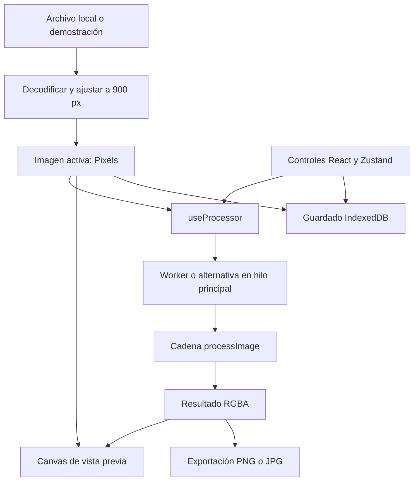

# Funcionamiento de Pliegue

Documentación del código actual, revisada el 18 de noviembre de 2026.

## 1. Qué hace la aplicación

Pliegue es un editor experimental de imágenes para crear composiciones mediante espejos, cortes y recomposición de píxeles. Trabaja con una imagen activa; permite mantener varias imágenes importadas en la sesión y cambiar entre ellas.

El procesamiento ocurre en el navegador. No hay un servidor de procesamiento de imágenes ni una subida de los archivos importados. El alojamiento sirve los archivos de la aplicación y la demostración incluida.

**Estado actual del shader:** Pixel smooth está temporalmente deshabilitado tanto en la interfaz como en el motor. Su implementación se conserva para reactivarla. Un proyecto antiguo con `smoothing: true` tampoco lo ejecuta.

La imagen a la que se llama «original» es la imagen de trabajo decodificada y reducida, cuando corresponde, a un máximo de 900 px en su lado mayor. No es una copia del archivo original a resolución completa.

## 2. Mapa de archivos y responsabilidades

| Archivo | Responsabilidad |
| --- | --- |
| `index.html` | Documento HTML inicial, idioma, metadatos, título y nodo `root`. |
| `src/main.tsx` | Monta React en `root`, activa `StrictMode` e importa `minimal.css`. |
| `src/App.tsx` | Orquesta importación, imagen activa, controles, restauración, guardado, comparación, mensajes y exportación. |
| `src/store.ts` | Estado global Zustand: parámetros del filtro y selección antes/después. |
| `src/config/features.ts` | Interruptores de producto compilados con la aplicación. Actualmente deshabilita Pixel smooth. |
| `src/components/Preview.tsx` | Dibuja los píxeles en Canvas y presenta el toggle antes/después. |
| `src/components/Parameter.tsx` | Sincroniza un slider con un campo numérico y valida sus límites. |
| `src/minimal.css` | Presentación visual, distribución adaptable, controles nativos y mensajes. |
| `src/hooks/useProcessor.ts` | Coordina procesamiento asíncrono, espera de 55 ms y descarte de resultados antiguos. |
| `src/engine/filter.ts` | Define `Pixels`, `FilterParams`, los valores iniciales y la cadena de efectos. Implementa espejo y entrelazado. |
| `src/engine/effects.ts` | Muestreo, ajuste proporcional, giros, preparación de baldosas, color, blur y mezcla. |
| `src/engine/smoothing.ts` | Implementación conservada de Pixel smooth: GLSL/WebGL2 y alternativa CPU. |
| `src/engine/filter.worker.ts` | Recibe solicitudes del editor, ejecuta el motor y devuelve el resultado. |
| `src/lib/images.ts` | FileReader, decodificación de imágenes, normalización del tamaño y conversión de píxeles a Canvas. |
| `src/lib/storage.ts` | Lectura y escritura del último proyecto en IndexedDB. |
| `public/estudio.svg` | Ilustración de demostración distribuida con la aplicación. |
| `src/engine/*.test.ts` | Pruebas unitarias de los algoritmos y del bloqueo temporal del shader. |
| `e2e/editor.spec.ts` | Pruebas de integración con Chromium y Firefox. |
| `vite.config.ts` | Configuración de Vite con los plugins React y Tailwind. |
| `vitest.config.ts` | Limita las pruebas unitarias a `src/**/*.test.ts`. |
| `playwright.config.ts` | Navegadores, servidor local, URL, concurrencia y trazas de integración. |
| `tsconfig.json` | TypeScript estricto, JSX React y comprobación sin emisión de JavaScript. |
| `package.json` / `package-lock.json` | Comandos, dependencias declaradas y versiones resueltas. |
| `.openai/hosting.json` | Identidad del sitio y directorio estático que se publica: `dist`. |
| `.gitignore` | Excluye dependencias, compilaciones, capturas y resultados temporales del control de versiones. |

React, Zustand y Canvas intervienen directamente en la ejecución actual. Konva, react-konva y lucide-react siguen declarados como dependencias de etapas anteriores, pero la interfaz actual no los importa. Tailwind permanece configurado como plugin; la presentación actual se escribe como CSS convencional en `minimal.css`.

## 3. Recorrido general de los datos



La alternativa «Antes» del visor utiliza la original de trabajo. «Después» utiliza el resultado. Exportar siempre utiliza el resultado procesado, incluso si el visor está mostrando «Antes».

## 4. Modelo de píxeles

```ts
interface Pixels {
  width: number;
  height: number;
  data: Uint8ClampedArray;
}
```

Cada píxel ocupa cuatro posiciones consecutivas: rojo, verde, azul y alfa, con valores de 0 a 255. El inicio del píxel `(x, y)` se obtiene con:

```text
índice = (y × width + x) × 4
```

El tamaño de `data` es `width × height × 4`. `Uint8ClampedArray` redondea y limita los valores escritos a su intervalo válido. Las funciones que realizan una modificación crean normalmente un nuevo búfer; los efectos neutros pueden devolver el mismo objeto de entrada.

Los tamaños de salida se calculan sobre estos píxeles de trabajo. El tamaño visual en CSS no cambia la resolución del resultado exportado.

## 5. Inicialización y restauración

Al montar `App`:

1. Se intenta leer la clave `latest` de IndexedDB.
2. Si existe un proyecto, se decodifica su PNG guardado y se restauran sus parámetros.
3. Los parámetros guardados se combinan con `defaults`, para que proyectos antiguos reciban los nuevos campos.
4. Si el proyecto no tiene `uiVersion: 2`, el giro de las tiras se migra a antihorario. Las elecciones posteriores guardadas con esa versión se respetan.
5. Si no existe un proyecto, se carga `public/estudio.svg`.
6. La imagen activa y los parámetros disparan el procesamiento.

El efecto de inicialización utiliza una marca de cancelación y `importGeneration`. Así evita que una restauración que termina tarde sustituya una importación iniciada por el usuario. `StrictMode` puede montar y limpiar efectos adicionalmente en desarrollo; los efectos de carga y el Worker incluyen limpieza.

El nombre del preajuste es estado de interfaz y no se guarda dentro de `SavedProject`. Restaurar parámetros no deduce automáticamente el nombre del preajuste del que provienen.

## 6. Importación y biblioteca de sesión

`readFile` transforma cada archivo en una URL `data:` mediante FileReader. `loadImage` espera a que un elemento `Image` lo decodifique. `decodeImage` dibuja la imagen en un Canvas temporal y obtiene su `ImageData`.

El factor de ajuste es:

```text
ratio = min(1, 900 / max(ancho, alto))
ancho de trabajo = max(1, round(ancho × ratio))
alto de trabajo  = max(1, round(alto × ratio))
```

No se amplían imágenes pequeñas durante la importación. La miniatura guardada como `thumbnail` es un PNG de la imagen de trabajo, no del resultado del filtro.

La función conserva un argumento histórico `sample`: cuando es verdadero, toma el cuadrante superior izquierdo antes de ajustar el tamaño. El flujo normal actual no lo activa; la demostración se carga completa.

La interfaz admite PNG, JPEG, WebP, GIF, BMP y AVIF, sujeto a la capacidad de decodificación del navegador. La validación utiliza el tipo MIME del archivo. El límite por archivo es 30 MiB (`30 × 1024 × 1024` bytes), aunque el mensaje abrevia como «30 MB». SVG se utiliza internamente para la demostración, pero no se acepta como archivo importado desde el selector.

Los archivos se procesan secuencialmente. Una importación múltiple puede tener éxitos y errores: se conservan los archivos válidos y se muestra el detalle de los fallos. Se retienen las últimas 12 imágenes de la sesión; si se importan más, también se decodifican antes de recortar esa lista. La última importada válida pasa a ser la activa.

La misma ruta se utiliza al arrastrar archivos sobre la aplicación. Las animaciones se convierten en el fotograma capturado al importar; no hay línea de tiempo ni exportación animada.

## 7. Parámetros y valores iniciales

| Campo | Control / significado | Valores | Inicial |
| --- | --- | --- | --- |
| `stripWidth` | Grosor de tiras y lado n de las baldosas | Entero 1–96 px | 8 |
| `iterations` | Pasadas completas de entrelazado | Entero 1–12 | 2 |
| `reverse` | Extremo inicial | `false`: izquierda; `true`: derecha | `false` |
| `clockwise` | Giro de cada tira | `false`: antihorario; `true`: horario | `false` |
| `quadrantRotations` | Giro de los cuatro cuadrantes iniciales | Cuatro ángulos entre 0°, 90°, 180°, 270° | `[0, 0, 0, 0]` |
| `tileRotation` | Giro de cada baldosa final | 0°, 90°, 180°, 270° | 0 |
| `contrast` | Contraste | Entero −100–100 | 0 |
| `saturation` | Saturación | Entero 0–200 % | 100 |
| `blurType` | Desenfoque | `none`, `gaussian`, `box` | `none` |
| `blurStrength` | Intensidad del blur | Entero 0–30 px | 0 |
| `mix` | Mezcla final con la original | Entero 0–100 % | 100 |
| `smoothing` | Preferencia conservada del shader | Booleano; ignorado mientras esté deshabilitado | `false` |
| `smoothingStrength` | Intensidad conservada del shader | Entero 0–100 %; control oculto actualmente | 75 |

El orden de `quadrantRotations` es: superior izquierdo, superior derecho, inferior izquierdo e inferior derecho. Los ángulos positivos de cuadrantes y baldosas giran en sentido horario.

Los límites se aplican en los controles. El motor también limita pasadas, grosor y algunos efectos, pero no sustituye una validación completa de un proyecto arbitrario manipulado externamente.

### Preajustes

| Nombre | Grosor | Repeticiones |
| --- | --- | --- |
| Entrelazado | 8 | 2 |
| Fragmentos | 32 | 2 |
| Trama fina | 2 | 4 |

Elegir un preajuste restablece **todos** los parámetros a `defaults` y luego aplica su grosor y sus repeticiones. Cambiar un control marca el selector como «Personalizado». Restablecer vuelve a los valores iniciales y selecciona «Después».

## 8. Cadena exacta del motor

`processImage`, en `src/engine/filter.ts`, aplica este orden. El orden visual de los controles no determina el orden de cálculo.

```text
Original de trabajo
  → espejo automático 2×2
  → giros independientes de los cuatro cuadrantes
  → completar dimensiones a múltiplos de n
  → entrelazado, repetido según iterations
  → giro de cada baldosa n×n
  → saturación y contraste
  → Pixel smooth [OMITIDO: deshabilitado temporalmente]
  → blur Box / Gaussian
  → mezcla con la original de trabajo
  → resultado
```

### 8.1 Espejo automático: `mirrorGrid`

Una entrada de `w × h` produce `2w × 2h`. El cuadrante superior izquierdo contiene la original; el derecho es su reflejo lateral. Ambos se reflejan hacia abajo. No existe una opción visible para desactivarlo ni un campo `mirror` vigente en `FilterParams`.

El mapeo de una coordenada de salida hacia la entrada es:

```text
sx = x < w ? x : 2w − 1 − x
sy = y < h ? y : 2h − 1 − y
```

Se copian los cuatro canales. Cada píxel aparece cuatro veces antes de los siguientes ajustes.

### 8.2 Giro de cuadrantes: `rotateQuadrants`

Se extrae cada celda, se gira mediante `rotateImage` y se ajusta proporcionalmente de nuevo al tamaño de su celda con `fitImage`.

`rotateImage` es una función auxiliar interna capaz de girar y ampliar el lienzo. En el producto actual no hay un control de rotación global: se usa aquí para cada cuadrante. Si una celda rectangular gira 90° o 270°, se intercambian sus proporciones; el ajuste posterior puede dejar margen transparente para evitar deformación o recorte. Las celdas cuadradas no requieren ese margen.

### 8.3 Preparación de baldosas: `padToTiles`

Con `n = stripWidth`, las dimensiones se completan así:

```text
W = ceil(ancho / n) × n
H = ceil(alto / n) × n
```

Las posiciones añadidas copian el último píxel disponible de su fila o columna. El relleno se hace solo hacia la derecha y hacia abajo. No se elimina la imagen original ni se la estira para completar la cuadrícula.

Ejemplo: una cuadrícula de `840 × 1040` con `n = 12` pasa a `840 × 1044`. El espejo alcanza como máximo 1800 px por lado antes de este relleno; completarlo puede superar ligeramente ese tamaño.

### 8.4 Corte y apilado: `weave`

Se divide la imagen en tiras verticales de grosor n. Se mantienen índices hacia los extremos de esa lista y se alterna entre ambos:

```text
Inicio izquierda: 0, último, 1, penúltimo, 2, ...
Inicio derecha:   último, 0, penúltimo, 1, ...
```

Cada tira gira 90° según `clockwise` y se apila de arriba abajo. Una entrada `W × H` produce `H × W`. Una pasada impar intercambia las dimensiones y una cantidad par las recupera. Cada repetición utiliza el resultado de la pasada anterior.

El algoritmo de bajo nivel también admite una última tira parcial y conserva sus píxeles. La cadena normal completa las dimensiones antes, por lo que trabaja con tiras enteras y mantiene dimensiones múltiplo de n durante todas las repeticiones.

### 8.5 Giro de baldosas: `rotateTiles`

Se divide el resultado en cuadrados n×n, anclados en la esquina superior izquierda. Cada cuadrado gira sobre su propio centro en 0°, 90°, 180° o 270°.

No se desplazan las baldosas dentro de la cuadrícula, no se gira la imagen completa y no se cambian las dimensiones. Los giros de 90° se realizan copiando píxeles: no necesitan interpolación. Con n = 1, girar una baldosa de un píxel no produce un cambio visible.

### 8.6 Saturación y contraste: `adjustColor`

Primero se calcula una luminancia ponderada sobre los canales RGB almacenados:

```text
L = 0.2126R + 0.7152G + 0.0722B
s = saturation / 100
canal saturado = L + (canal − L) × s
```

0 % convierte a grises; 100 % mantiene la saturación; 200 % duplica la separación respecto de la luminancia. No es una conversión a HSL ni una operación sobre luz lineal.

Después se aplica contraste alrededor de 128:

```text
f = 259 × (contrast + 255) / (255 × (259 − contrast))
canal final = f × (canal saturado − 128) + 128
```

La escritura en `Uint8ClampedArray` limita el resultado. El alfa se conserva. Estos ajustes se calculan antes de la mezcla con la original.

### 8.7 Pixel smooth: implementación conservada y deshabilitada

El bloqueo central es `PIXEL_SMOOTH_ENABLED = false`, en `src/config/features.ts`. La interfaz y el motor consultan el mismo valor. No depende de que el control guardado diga `false`: incluso con `smoothing: true`, `processImage` omite esta etapa.

Las preferencias históricas no se borran de IndexedDB. El código del shader y sus pruebas directas se conservan; ejecutar una prueba del algoritmo no significa que esté activo en el editor.

El algoritmo es una implementación propia inspirada en filtros de emuladores, no un port exacto de xBR. Compara el píxel central con sus vecinos norte, sur, este y oeste. Busca parejas de colores semejantes junto a esquinas y comprueba los vecinos opuestos para conservar líneas rectas y puntos aislados. Mezcla las esquinas detectadas con una fuerza graduable, sin ampliar la imagen.

La ruta GPU compila GLSL para WebGL2, sube la imagen a una textura con muestreo cercano, dibuja un triángulo que cubre el lienzo y recupera RGBA con `readPixels`. Reutiliza el contexto, el programa y la textura. Se usa un `OffscreenCanvas`; si falta soporte, se pierde el contexto, falla la compilación o la textura supera el límite del dispositivo, la ruta devuelve `null` y se utiliza CPU.

La ruta CPU utiliza las mismas comparaciones y pesos sobre canales premultiplicados. Puede diferir un nivel de canal respecto de GPU por redondeo. Las pruebas comparan ambas rutas cuando WebGL2 está disponible.

### 8.8 Blur: `blurImage`

Con tipo `none` o intensidad 0 se devuelve la entrada sin cambios.

**Box** utiliza un promedio uniforme de radio r. Una ventana tiene `2r + 1` muestras por eje. Se calcula una pasada horizontal y otra vertical, con sumas deslizantes; el trabajo por píxel no crece con el radio. Al salir de la imagen se repite el píxel del borde.

**Gaussian** utiliza tres filtros Box cuyos tamaños se eligen para aproximar una distribución gaussiana con la varianza correspondiente a la intensidad. Es una aproximación eficiente, no una convolución gaussiana exacta.

Antes del promedio se premultiplica RGB por alfa y se usan búferes Float32. Al terminar se recupera RGB dividiendo por alfa. Esto evita introducir bordes negros al desenfocar transparencias.

### 8.9 Mezcla final: `mixOriginal`

La otra rama de la mezcla siempre es la original de trabajo, sin espejo, giro, color, shader ni blur. `fitImage` la ajusta proporcionalmente al tamaño de salida, centrada y con transparencia donde sobren márgenes.

```text
t = mix / 100
A = alfa_resultado × t
B = alfa_original × (1 − t)
alfa_salida = A + B
RGB_salida = (RGB_resultado × A + RGB_original × B) / (A + B)
```

Si el alfa total es cero, el color queda transparente. 0 % devuelve la original ajustada; 100 % devuelve todos los efectos. Por tanto, 0 % de intensidad final oculta también el contraste, la saturación y el blur.

`fitImage` y las rotaciones interpoladas utilizan muestreo bilineal sobre alfa premultiplicado para evitar halos oscuros. El ajuste proporcional puede generar márgenes cuando cambian las proporciones por pasadas impares o por el relleno de baldosas.

## 9. Estado global y controles

`useEditor` mantiene `params` y `before`. `setParam` reemplaza un campo de manera inmutable; `setParams` reemplaza el conjunto; `setBefore` cambia la comparación; `reset` restablece parámetros y «Después».

Las imágenes importadas, la imagen activa, el formato de exportación, el nombre del preajuste y los mensajes pertenecen al estado local de `App`, no a Zustand.

`Parameter` mantiene un borrador de texto para permitir una edición numérica incompleta. Si el número introducido es válido y está dentro de los límites, actualiza inmediatamente el parámetro. Al perder el foco o pulsar Enter, redondea y limita el valor; si el campo está vacío, recupera el valor vigente. El slider y la caja numérica se sincronizan mediante el mismo parámetro.

Las rotaciones y modos se seleccionan con controles nativos. Las cuatro cajas de giro de cuadrantes se distribuyen espacialmente en 2×2 para identificar su posición.

## 10. Procesamiento asíncrono y Worker

`useProcessor` intenta crear un Worker de tipo módulo al montar el componente. Cuando cambian la fuente o los parámetros:

1. Incrementa un identificador de generación.
2. Marca el procesamiento como ocupado y limpia el error anterior.
3. Espera 55 ms desde el último cambio; si llega otro antes, cancela ese temporizador.
4. Envía `{ id, source, params }` al Worker, o ejecuta el motor en el hilo principal si no dispone de Worker.
5. Solo acepta un resultado cuyo `id` coincida con la generación vigente.

El mensaje normal de respuesta es `{ id, result }`; un fallo capturado devuelve `{ id, error }`. La imagen de entrada se clona al enviarla. El búfer de salida se transfiere con la lista `transfer`, para evitar otra copia del resultado.

Al desmontar se termina el Worker. Si se produce un error de ejecución del Worker detectado por `onerror`, se termina y se utiliza la alternativa principal.

La generación descarta resultados obsoletos, pero no cancela cálculos ya iniciados ni elimina por sí sola mensajes en cola. La espera de 55 ms es un debounce, no una garantía de actualización a 60 fps. La alternativa en el hilo principal puede bloquear temporalmente la interfaz con operaciones pesadas.

## 11. Vista previa e interfaz

`Preview` recibe la fuente seleccionada y copia su RGBA al Canvas mediante `putImageData`. Los atributos `width` y `height` corresponden a la resolución real. CSS limita la presentación para que la imagen quepa en su espacio.

La imagen aparece sin marco, sobre el fondo de la página. No hay herramientas de selección, desplazamiento ni zoom. El toggle inferior modifica únicamente qué búfer se dibuja.

En escritorio, `minimal.css` organiza imagen y controles en dos columnas y mantiene la columna de imagen con posición `sticky`. En pantallas de hasta 760 px pasa a una columna. Las miniaturas solo se muestran cuando hay más de una imagen en la sesión.

Los controles tienen etiquetas o nombres accesibles. `aria-busy` indica que hay procesamiento, y los mensajes de estado usan regiones accesibles. El estado de guardado es actualmente texto oculto visualmente (`sr-only`); no hay una barra de estado visible.

## 12. Persistencia local

| Elemento | Valor |
| --- | --- |
| Base IndexedDB | `pliegue` |
| Versión de base | 1 |
| Almacén | `projects` |
| Clave | `latest` |
| Espera de autoguardado | 650 ms desde el último cambio |

```ts
interface SavedProject {
  name: string;
  image: string;       // PNG data URL de la original de trabajo
  params: FilterParams;
  uiVersion?: 2;
}
```

Se guarda solo el último proyecto activo: nombre, imagen de trabajo y parámetros. No se persisten toda la biblioteca de sesión, el resultado procesado, el formato JPG/PNG, el toggle ni el nombre del preajuste. El resultado se vuelve a calcular al abrir.

El guardado utiliza una transacción de escritura y espera a que se complete. Las funciones cierran la conexión después de leer o escribir. Al cambiar rápidamente los parámetros, se cancela el temporizador de guardado anterior.

El almacenamiento está separado por origen, navegador y perfil. Un proyecto de `localhost` no aparece automáticamente en el sitio publicado. Borrar los datos del sitio elimina el proyecto. No hay sincronización con cuentas, historial de versiones de proyecto ni garantía de escritura si se cierra la página antes de completar el autoguardado.

Los fallos de IndexedDB actualizan el estado accesible de guardado; la edición puede continuar. No se utiliza `localStorage` como alternativa.

## 13. Exportación

`exportImage` exige un resultado disponible y rechaza la acción mientras el motor o la exportación estén ocupados. Se crea un Canvas con el RGBA final.

- **PNG:** conserva el alfa y los márgenes transparentes.
- **JPG:** pinta blanco por detrás con `destination-over`; se solicita calidad 0.95 a `toBlob`.

El nombre es `<nombre-sin-extensión>-pliegue.png` o `.jpg`. Se crea una URL de objeto temporal, se activa la descarga con un enlace y se revoca la URL después de 10 segundos.

La resolución corresponde al procesamiento, incluido el relleno a múltiplos de n y el intercambio de dimensiones de pasadas impares. No se exporta la captura del visor ni la resolución nativa del archivo importado cuando fue reducido.

## 14. Pruebas y verificación

```sh
npm test
npm run build
npx playwright install chromium firefox
npm run test:e2e
```

Vitest verifica el motor sin depender de React: espejo, orden de tiras, conservación de RGBA, repeticiones, giros de cuadrantes y baldosas, ajuste proporcional, blur, saturación, mezcla y comportamiento del shader conservado. Incluye una regresión que comprueba que los parámetros de suavizado guardados no activan el shader mientras el interruptor de producto sea falso.

Playwright prueba Chromium y Firefox: distribución, controles, comparación, importación múltiple, restauración, migración del giro histórico, color, blur, baldosas, descarga, diseño móvil y alternativa sin Worker. También prueba directamente el algoritmo GPU conservado y su equivalencia con CPU cuando hay WebGL2. La prueba de producto del shader verifica ahora que sus controles no aparezcan y que un proyecto guardado con el shader activo produzca una imagen sin suavizado.

La configuración usa dos trabajadores, un límite de 45 segundos por prueba y `http://127.0.0.1:5175`. Puede reutilizar un servidor existente en esa URL. Conserva trazas de fallos. Las capturas se guardan en `outputs/`, excluido de Git.

`npm run build` ejecuta TypeScript y Vite; produce los archivos estáticos y el Worker empaquetado dentro de `dist/`. El hecho de superar estas pruebas no garantiza rendimiento constante para todos los archivos o GPU.

## 15. Desarrollo y publicación

Se necesita una versión de Node compatible con las herramientas declaradas; la aplicación se ha desarrollado con Node 22.12. Para una instalación reproducible con el lockfile vigente:

```sh
npm ci
npm run dev
```

El script de desarrollo escucha en `127.0.0.1`. Vite indica el puerto disponible. `npm run preview` sirve la compilación ya generada. Ninguno de estos comandos publica automáticamente el sitio de producción.

La publicación gestionada utiliza Sites:

1. Se conserva la identidad de `.openai/hosting.json` y la audiencia privada existente.
2. Se ejecutan las verificaciones y la compilación que correspondan.
3. Se sincroniza el estado exacto del código con el repositorio del sitio.
4. Se empaqueta `dist/` junto con el manifiesto de alojamiento.
5. Se guarda y despliega una versión asociada al mismo commit.
6. Se espera un estado terminal satisfactorio antes de informar que está publicada.

Las credenciales de sincronización son temporales y no deben guardarse en archivos, documentación ni código. Las imágenes importadas y los proyectos de IndexedDB no forman parte del paquete publicado.

## 16. Cómo reactivar Pixel smooth

1. Cambiar `PIXEL_SMOOTH_ENABLED` a `true` en `src/config/features.ts`.
2. Volver a habilitar la prueba de interacción del shader y adaptar las regresiones que verifican el bloqueo temporal.
3. Probar GPU y alternativa CPU, transparencia, guardado, restauración y exportación.
4. Ejecutar pruebas, compilar y publicar una nueva versión.

El mismo interruptor habilita la etapa del motor y sus controles. No hace falta reconstruir el shader ni cambiar IndexedDB. Proyectos antiguos con la preferencia activada volverán a utilizarla al reactivar esta función; para empezar siempre apagado habría que definir explícitamente otra migración.

## 17. Límites y puntos de extensión

- La importación reduce el lado mayor a 900 px; no hay edición a resolución nativa de archivos grandes.
- La sesión contiene como máximo 12 imágenes seleccionables, sin mezcla multicapa.
- No hay deshacer/rehacer, máscaras, selección, zoom, movimiento ni exportación de proyectos como archivo.
- El guardado conserva un solo proyecto activo y depende de la cuota local disponible.
- Los errores de guardado están disponibles para tecnologías de asistencia, pero no se muestran actualmente como aviso visual dedicado.
- Las animaciones se tratan como una imagen fija.
- Gaussian es aproximado; Pixel smooth es una implementación propia conservada y temporalmente deshabilitada.
- El Worker evita bloquear la interfaz durante la mayoría del procesamiento, pero su alternativa principal puede bloquearla y los trabajos obsoletos no se cancelan físicamente.

Para añadir un efecto nuevo: ampliar `FilterParams` y `defaults`, implementarlo en `engine`, insertarlo explícitamente en `processImage`, añadir su control, verificar restauración de proyectos anteriores y probar transparencia, intensidad neutra y exportación. El visor y la exportación consumen el mismo `Pixels` final, por lo que no necesitan implementar el efecto otra vez.
